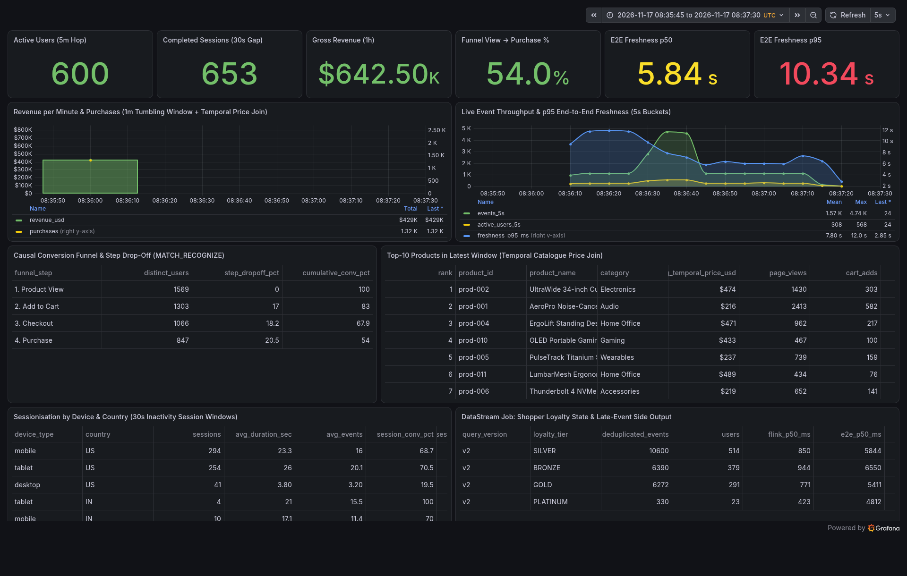
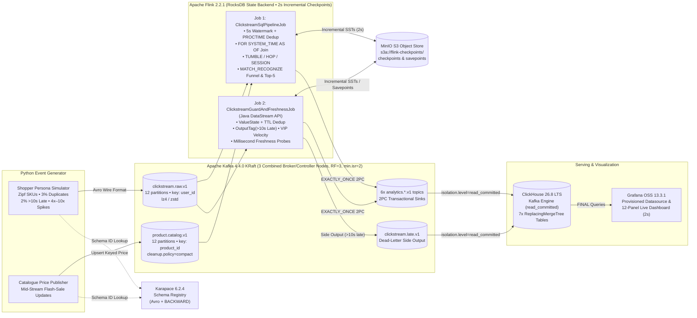

# Real-Time E-Commerce Clickstream Analytics on Apache Kafka 4.4 & Apache Flink 2.2

[](https://github.com/Manzoor25/kafka-flink-clickstream-ec2a/actions/workflows/ci.yml)
[](LICENSE)

An end-to-end, production-grade real-time e-commerce analytics platform built on **Apache Kafka 4.4.0 (KRaft)**, **Apache Flink 2.2.1 (SQL + DataStream API, RocksDB incremental checkpoints on S3/MinIO)**, **Karapace Schema Registry 6.2.4 (Avro)**, **ClickHouse 26.8 LTS**, and **Grafana 13.3.1**.

## The Problem

An e-commerce storefront needs an operational dashboard that stays **within a few seconds of live shopper behaviour**—even during flash-sale traffic spikes, network retries (duplicate events), mobile out-of-order/late arrivals, mid-sale product price changes, and worker node crashes:

1. **Active shoppers & revenue per minute** (1-minute tumbling windows and 5-minute / 1-minute hopping windows).
2. **Shopper sessionisation** (`SESSION` windows with a 30-second inactivity gap for real-time visibility; configurable to 30 minutes).
3. **4-step causal funnel conversion & step-by-step drop-off** (`view` $\rightarrow$ `add_to_cart` $\rightarrow$ `checkout` $\rightarrow$ `purchase` via `MATCH_RECOGNIZE`).
4. **Top-N revenue products per window** (`ROW_NUMBER()` Top-5 ranking per tumbling window).
5. **Point-in-time accurate pricing** via an event-time temporal join (`FOR SYSTEM_TIME AS OF`) against a compacted `upsert-kafka` product catalogue topic so clicks before and after a flash-sale markdown pick up the exact price valid at click time.
6. **End-to-end effective-once accuracy** across Flink 2-phase-commit (`EXACTLY_ONCE`) Kafka sinks and downstream `read_committed` ClickHouse consumers—verified continuously against an independent offline batch recount (`0` missing events, `$0.00` revenue drift).

---

## Live Provisioned Grafana Dashboard



*Provisioned declaratively as code (`grafana/dashboards/clickstream-realtime.json`) on Grafana OSS `13.3.1` with `2s` live auto-refresh across 12 panels covering KPI stat cards, tumbling/hopping revenue & active users, `MATCH_RECOGNIZE` funnel conversion, temporal-join Top-N products, active user sessions, late-event dead-letter auditing, and end-to-end p50/p95 freshness.*

---

## Architecture



---

## Pinned Stack & Measured Highlights

| Layer | Component & Pinned Version | Highlights & Measured Results (Single-Host 3-Broker Lab) |
|---|---|---|
| **Streaming Log** | **Apache Kafka `4.4.0`** (`apache/kafka:4.4.0`) | 3-node KRaft quorum (zero ZooKeeper), `RF=3`, `min.insync.replicas=2`. `lz4` achieves **2.25x** wire compression at **126,544 eps** (`18.54 MB/s`); `zstd` (`linger=20ms, batch=64KB`) achieves **3.62x** wire compression at **124,255 eps** (`ACK p50 = 124.51 ms`). |
| **Schema Registry** | **Karapace `6.2.4`** (`ghcr.io/aiven-open/karapace:6.2.4`) | Confluent wire-compatible Avro registry on compacted `_schemas` (`BACKWARD` compatibility). |
| **Stream Compute** | **Apache Flink `2.2.1`** (`flink:2.2.1-scala_2.12-java21`) | Unified 6-sink Flink SQL `StatementSet` + Java DataStream API guard job, RocksDB incremental checkpoints every `2,000 ms` (`17.98 MB` SQL / `1.54 MB` DataStream state). |
| **Checkpoint Store** | **Chainguard MinIO** (`sha256:59953701...`) | S3-compatible object storage (`s3a://flink-checkpoints`) surviving `SIGKILL` worker crashes and `v1` $\rightarrow$ `v2` savepoint upgrades. |
| **Serving Store** | **ClickHouse `26.8.38.9` LTS** | Native `librdkafka` `read_committed` consumers (`0` aborted records leaked vs `5/5` leaked under `read_uncommitted`) feeding `ReplacingMergeTree` tables. |
| **Dashboard** | **Grafana OSS `13.3.1`** + ClickHouse plugin `4.23.5` | End-to-end **Event Creation $\rightarrow$ Grafana HTTP `/api/ds/query` Freshness**: **`p50 = 3.90 s` (`3,902 ms`)**, **`p95 = 5.77 s` (`5,766 ms`)**, **`p99 = 6.19 s` (`6,188 ms`)** across 300 probes. |

---

## One-Command Quickstart

**Prerequisites:** Docker Engine `24+` with Docker Compose `v2` and `make` (`8 GB+` RAM recommended for the 10-container stack; Maven and Python run inside containers automatically if not installed locally).

```bash
# 1. Build images, boot the 3-broker KRaft + Flink + ClickHouse + Grafana cluster, and submit both Flink jobs
make up

# 2. Stream 75s of realistic shopper sessions, 3% duplicates, 2% late events, a 4x flash-sale spike,
#    and mid-stream -20% / +10% temporal catalogue price updates, then verify batch recount
make demo

# 3. Run all JUnit 5 MiniCluster SQL/DataStream tests, Python unit tests, and live streaming-vs-batch check
make test

# 4. Stop all containers and clean volumes
make down
```

### Local Endpoints (configurable via `.env`)

| Service | Default URL | Credentials |
|---|---|---|
| **Grafana Live Dashboard** | `http://localhost:3000/d/clickstream-realtime-v1` | `admin` / `admin` (anonymous viewer enabled) |
| **Flink Web UI** | `http://localhost:8081` | None |
| **ClickHouse HTTP SQL** | `http://localhost:8123` | `default` / `clickhouse_dev` |
| **Karapace Schema Registry** | `http://localhost:8085/subjects` | None |
| **MinIO S3 Console** | `http://localhost:9001` | `localdevminio` / `localdevminio123` |

### Additional Benchmarks & Operations Commands

```bash
make benchmark   # Run 9-point Kafka 4.4 codec (none/lz4/zstd) x linger.ms x batch.size matrix -> docs/benchmarks/
make freshness   # Run 300-probe end-to-end Grafana freshness + aborted-transaction isolation test
make status      # Inspect Kafka consumer group lag, Flink busy/backpressure ratios, and ClickHouse table counts
```

---

## Failure & Recovery Demos

Run `make up` first, then execute any of the four automated operational drills. Each script injects the fault or state transition, prints telemetry, and validates mathematical accuracy against an independent Kafka batch recount.

### 1. Kill an Active TaskManager Under Load (`make demo-kill-tm`)
Streams continuous traffic at `300 events/s` with duplicates and late arrivals, locates the TaskManager actively executing subtasks via the JobManager REST API, and kills it mid-window with `docker kill -s SIGKILL`. The standby TaskManager restores RocksDB incremental state from MinIO S3 within the `8s` heartbeat timeout and commits Kafka transactions without losing or double-counting a single cent.

```text
>>> Injecting chaos: docker kill -s SIGKILL flink-taskmanager-1 ...
  Job clickstream-sql-analytics     state=RUNNING  completed_ckpts=66  restored=1
  Job clickstream-datastream-guard  state=RUNNING  completed_ckpts=58  restored=1
Raw Kafka messages scanned    : 21048
Unique events (batch recount) : 10134
ClickHouse guard unique count : 10134  (missing=0, extra=0)
RESULT: PASS - Zero missing or duplicate events across Streaming SQL, Guard job, and Batch Recount.
```

### 2. Push a 10x Flash-Sale Traffic Spike (`make demo-spike`)
Establishes an `800 events/s` baseline and then blasts an **`8,278 events/s` (>10x)** burst (`88,000` events in `10.6s`) while sampling Kafka consumer lag and Flink operator `busyRatio` / `backpressureRatio` every `1.5s` until lag drains cleanly back to zero.

```text
Spike burst complete: 88,000 events sent in 10.63s (8,278 eps)
  [t= 11.4s] sql_lag=  72,944  guard_lag=  34,475  max_backpressure=0.49 (low)   max_busy=0.57
  [t= 13.7s] sql_lag=  84,000  guard_lag=  45,661  max_backpressure=0.00 (ok)    max_busy=0.39
  ...
  [t= 72.1s] sql_lag=       0  guard_lag=       0  max_backpressure=0.00 (ok)    max_busy=0.05
ClickHouse guard unique count : 98110  (missing=0, extra=0)
RESULT: PASS
```

### 3. Stateful Query Upgrade from Savepoint (`make demo-savepoint-upgrade`)
Seeds canary shopper `user-canary-*` with `12` events (`10` purchased units $\rightarrow$ `tier=VIP` under `v1` thresholds), stops `ClickstreamGuardAndFreshnessJob` with a canonical S3 savepoint (`s3a://flink-checkpoints/savepoints/savepoint-...`), publishes `4` additional purchases (`8` units) to Kafka while the job is offline, and deploys `--query-version v2` from the savepoint. Verify that `v2` resumes cumulative RocksDB state at event `#13..#16` (`18` units $\rightarrow$ new `PLATINUM` tier + `high_velocity_session=True`).

```text
Savepoint stored at: s3a://flink-checkpoints/savepoints/savepoint-d7424c-376806a0fab1
  seq=#12  ver=v1  tier=VIP       high_vel=False  event_id=canary-v1-12
  seq=#13  ver=v2  tier=VIP       high_vel=True   event_id=canary-v2-13
  seq=#15  ver=v2  tier=PLATINUM  high_vel=True   event_id=canary-v2-15
  seq=#16  ver=v2  tier=PLATINUM  high_vel=True   event_id=canary-v2-16
[DEMO 3 PASS] Savepoint upgrade preserved RocksDB state across offline gap and activated v2 logic.
```

### 4. Kappa Architecture Earliest-Offset Reprocessing (`make demo-reprocess`)
Snapshots all ClickHouse revenue, session, and funnel metrics, runs `TRUNCATE TABLE` across all 7 serving tables (`$0.00` revenue, `0` rows), resets Flink consumer groups, and replays `clickstream.raw.v1` and `product.catalog.v1` from `earliest-offset`. Because Kafka retains the immutable event log and `ReplacingMergeTree` keys windows deterministically, the streaming engine rebuilds **penny-for-penny identical historical aggregates** without maintaining a separate batch codebase.

```text
Pre-wipe baseline : windows=3  revenue=$213693.70  sessions=598  guard_events=10134
Post-truncate check (all 0): minute_rows=0, session_rows=0, guard_rows=0
Post-replay rebuilt: windows=3  revenue=$213693.70  sessions=598  guard_events=10134
RESULT: PASS - Zero missing or duplicate events across Streaming SQL, Guard job, and Batch Recount.
```

---

## Documentation & Repository Map

- [`docs/design.md`](docs/design.md) — Requirements, partition sizing maths, codec benchmarks, watermark/lateness policy, RocksDB state sizing, hop-by-hop guarantees, ClickHouse vs Pinot analysis, trade-offs, and production roadmap.
- [`docs/adr/`](docs/adr/README.md) — 7 concise Architecture Decision Records (`ADR-0001` through `ADR-0007`).
- [`docs/interview-questions.md`](docs/interview-questions.md) — 10 deep architectural & operational Q&As for technical interviews and customer design reviews.
- [`docs/benchmarks/`](docs/benchmarks/producer_benchmark.md) — Raw JSON & Markdown producer compression/batching and end-to-end freshness reports.
- [`docs/linkedin-article.md`](docs/linkedin-article.md) & [`docs/linkedin-post.md`](docs/linkedin-post.md) — First-person engineering write-up and short teaser post.
- [`flink/`](flink/) — Flink `2.2.1` SQL scripts (`01_sources_kafka.sql`, `02_views.sql`, `03_sinks_kafka.sql`), Java runners (`ClickstreamSqlPipelineJob`, `ClickstreamGuardAndFreshnessJob`), and 8 JUnit 5 MiniCluster tests against fixed JSONL fixtures.
- [`clickhouse/`](clickhouse/) & [`grafana/`](grafana/) — `read_committed` Kafka Engine consumers, `ReplacingMergeTree` DDL, and declarative Grafana provisioning.
- [`generator/`](generator/) & [`scripts/`](scripts/) — Avro shopper simulator, batch recount verifier, benchmark & freshness harnesses, savepoint tooling, and 4 chaos/ops demo scripts.

## License

Licensed under the [Apache License, Version 2.0](LICENSE).
